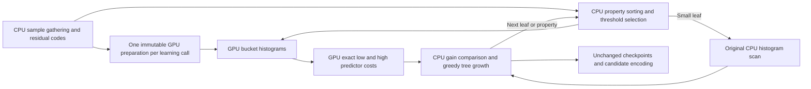

# Exact GPU statistics for the original Modular learner

Status: native Metal operation, complete-search integration and local M4 Pro
qualification are complete. See the
[three-route performance report](gpu-adaptive-modular-learning.md). This completes
milestone 4 of [the adaptive GPU plan](gpu-adaptive-modular.md).
The earlier ANS qualification uses the frozen `2009da7` implementation and does
not include this operation.

## Measured target and policy boundary

The original learner remains a substantial CPU cost after GPU token generation
and exact ANS costing. Its property sorting and split scanning dominate learning.
This slice accelerates the histogram work and threshold costs inside
`FindSplit`, while retaining CPU property sorting, threshold enumeration, greedy
tree growth and checkpoint capture. It does not substitute the quantized learner
or reduce training samples, properties, predictors, thresholds or leaf limits.

The scalar learner considers all 14 predictors, using a fixed HybridUint 4/2/0
residual proxy and integer Q12 entropy estimates. For each leaf it sorts sample
indices by `(property value, original sample index)`, in ascending property order.
It chooses actual property boundaries near 32 quantiles, requires at least eight
samples on either side, and accepts only thresholds in `[INT32_MIN, INT32_MAX)`.
Equal property values are never split. Invalid boundaries do not advance the
quantile counter. Those exact rules determine the GPU input; the GPU does not
choose alternate thresholds.



Parent predictor selection stays on the CPU in this slice. The GPU replaces the
expensive incremental low/high histogram updates for eligible leaves. Each
candidate still uses the same parent cost, split-bit penalty, strict gain
comparison, Gradient-first predictor preference, ascending predictor tie order,
property order and threshold order. The best-first leaf selector and retained
checkpoint priorities remain unchanged.

## Operation boundary

Use an optional private backend capability and a call-local learner evaluator,
passed explicitly into the original learner. No ambient GPU override is added.
The evaluator is scoped to one `LearnEntropyTree` call and cannot retain samples
or prepared state across later learning calls.

1. **Prepare immutable residual codes and count costs.** Borrow the original
   learner's `N × 14` residual codes and its `N + 1` Q12 `n * Log2(n)` table.
   Validate code ranges, symbol/extra-bit consistency and the canonical count
   table, then copy into a completed shared device owner. The symbol is uint8,
   the extra-bit count is uint8, and code records are exactly two bytes. The zero
   count entry is zero. CPU learning samples and its existing scratch remain
   separately owned and admitted.
2. **Evaluate one sorted property of one leaf.** Borrow that prepared owner, a
   leaf's ordered uint32 sample indices, and up to 32 strictly increasing low-side
   counts chosen by the unchanged threshold rules. The counts partition the
   ordered leaf into at most 33 nonempty buckets. Return exact int64 low/high
   costs for all 14 predictors at every requested threshold, in caller order.
3. **Select on the CPU.** Apply the existing predictor preference and strict gain
   comparison to these costs. Keep the original order vector, including its
   final-property sorting before `std::partition` creates the two children.

Preparation should occur lazily on the first eligible leaf and be reused across
properties and later leaves in the same learning call. This avoids repeated
uploads of the immutable codes/count table. Property batches remain bounded;
there is no `16 × N` array of independently sorted properties and no simultaneous
encoding of unrelated tree candidates.

An eligible property with no valid threshold skips histogram evaluation entirely.
It still counts as a sorted property, but produces neither a GPU group nor a
scalar-fallback property count. The incremental hybrid timing includes this exact
CPU threshold preflight as well as device work; it is not a kernel-only speedup.

The standalone operation accepts valid small batches for direct qualification.
The workflow uses an explicit leaf-size crossover determined by measurement.
Missing capability and unsupported preflight shapes can decline before device
work. Small leaves retain the original CPU scan. Allocation, submission,
completion and data errors after an attempted operation are terminal; they must
not silently retry a different execution path.

## GPU algorithm and exact arithmetic

The first dispatch assigns one threadgroup to each `(bucket, predictor)`.
Threads gather residual symbols through the sorted sample indices and build a
128-symbol histogram using threadgroup uint32 atomics. Integer count increments
are order-independent. Every bucket's maximum population is at most `N`, bounded
by the original learner's `1 << 20` sample ceiling.

The second dispatch assigns a group to each `(threshold, side, predictor)`.
Each lane handles a symbol, sums that symbol's bucket counts for the requested
side, and contributes the exact integer cost. For histogram counts `h[s]` and
side population `n`, the result is:

```text
count_log_count[n] - sum_s(count_log_count[h[s]])
  + 4096 * (sum_s(h[s] * extra_bits[s]) + 2 * occupied_symbols + 8)
```

For this fixed residual proxy, symbols below 16 have zero extra bits; otherwise
`extra_bits[s] = 2 + (s - 16) / 4`. Prepared codes must agree with that relation.
Thus histogram counts determine the extra-bit sum exactly. Int64 reduction of
these bounded integer terms introduces no floating-point reassociation or tie
changes. Both dispatches can share one submission with the required device
memory ordering; completion precedes host cost publication.

No per-sample ANS state, weighted-predictor state, or model normalization enters
this operation. Training-sample collection and the full-raster weighted scan
remain CPU work and stay inside the complete-search timer.

## Storage and ownership

Let `N` be prepared samples, `L <= N` the leaf population, and `M <= 32` the number
of requested thresholds. All size calculations and preflight checks must be
allocation-free, checked and failure-atomic.

- Prepared backing holds `28N` bytes of residual codes and `8(N + 1)` bytes of
  count costs, with the cost-table region starting at a 256-byte boundary.
- Evaluation backing holds `4L` bytes of indices, `4(M + 2)` bytes of bucket
  boundaries, `(M + 1) × 14 × 128 × 4` bytes of histogram scratch, and a uint32
  status word. Each region begins at a 256-byte boundary.
- Completed cost backing holds `M × 2 × 14 × 8` bytes, threshold-major, then
  low/high side, then predictor wire ID. The maximum histogram scratch is
  236,544 bytes and the maximum completed cost array is 7,168 bytes.
- Conservative bounds include fresh host staging where the interface allows it;
  direct shared-memory initialization may consume less. Prepared backing remains
  live during evaluation. Caller-owned old outputs are charged separately.
- The workflow composes the operation peak with CPU training samples, existing
  learner scratch/checkpoints, retained GPU feature caches, the best compressed
  candidate and eventual publication bounds. No discount is taken merely because
  a later shape or capability may choose the CPU path.

The operation validates native backend ownership, prepared dimensions and fixed
record layouts before borrowing device storage. Threshold counts must be strictly
increasing, at least eight, and at most `L - 8`. Indices address the prepared
sample set; invalid device indices must set status without an out-of-bounds read.
The primitive may evaluate a multiset of valid indices, but the original learner
continues to supply the unique membership of its leaf. The caller owns sorting
and membership invariants.

Inputs remain immutable through completion. Returned spans borrow completed
owner backing and survive only as long as that owner. Error paths drain pending
work, release new backing, and preserve prior output costs, trees, checkpoints
and compressed files. Stacks, inline control records, backend initialization,
allocator metadata and driver allocations follow the existing managed-backing
exclusions.

## Integration and qualification gates

1. Define the operation, prepared/completed owners, fixed device records,
   allocation-free storage plan and private learner evaluator interface. Test
   dimensions, malformed codes/tables/partitions, overflow, native limits and
   unchanged outputs on failed validation in both Metal and CPU-only builds.
2. Implement Metal bucket histograms and exact integer reductions. Compare every
   predictor's low/high costs with an ordinary scalar histogram oracle, covering
   all 128 residual symbols, signed residual extrema, constant/skewed/random
   distributions, empty candidate lists at the caller, one/32 thresholds, small
   and maximum-size leaves, arbitrary valid sample indices and reordered samples.
   Qualify input guards, owner lifetime, exact storage, one-byte-short capacity,
   allocation/submission/completion faults and invalid-index status handling.
3. Connect it to the original learner with a measured small-leaf CPU crossover.
   Compare complete node arrays and every retained checkpoint against the original
   CPU path, including duplicate/extreme property values, quantile skips, ties,
   early stopping, depth limits, all predictor choices and allocation failures.
   Preserve fallback and post-submission error semantics through complete search.
4. Add explicit preparation/evaluation/fallback counts and nested elapsed time.
   Verify profile-disabled bytes and actual backend submission accounting. The
   existing semantic split/sort work counters must still match the CPU search.
5. Freeze the implementation and repeat complete-call CPU, token/ANS hybrid, and
   learner-statistics hybrid controls on 1029/1039/1049 with identical budgets.
   Include uploads, waits, CPU sorting, sample gathering, all candidates and
   publication. Verify exact files, selected policies, checkpoints where exposed,
   pinned decoding and admitted/observed backing before reporting speedups.

Sorting remains an explicit CPU cost in this first statistics implementation.
GPU sorting or shared weighted features between learning and encoding are later
optimizations, contingent on the new measurements; they are not substitutes for
implementing and qualifying the statistics operation above.

## Implemented validation (Apple M4 Pro)

The Release build and all 38 selected existing Modular/entropy/Metal regressions
pass. The new allocation-free contract also passes with Metal disabled, alongside
the CPU profile, training-budget and completed-token-handoff tests.

The native test compares 346 exact batches, including 87,752 predictor costs and
3,288,320 indexed samples, with independent scalar histograms. It covers external
and embedded libraries, all residual symbols, one million prepared samples,
reordered and repeated indices, exact storage limits, owner lifetimes, invalid
indices and allocation/submission/completion errors. The production learner
adapter additionally preserves complete trees and all retained checkpoints with
profiling enabled or disabled. Injected device failures on either the first
property or a later reuse propagate without scalar retry, preserve existing
outputs and release the call-local prepared owner.

Complete-search tests compare 48 CPU/hybrid files, independently decode
13,142,985 samples and complete 3,903 failure-atomic checks, covering integer grayscale/RGB/RGBA formats, palette layouts, checkpoints,
legacy and expanded quantized-search fallback, profile-disabled calls and owned
publication. Admission below the composed bound rejects before work. An attempted
statistics preparation that returns either Unsupported or DeviceError is terminal
through full search and preserves the caller's old compressed output.

`--metal-learn` enables GPU tokens, exact ANS costing and original-learner
statistics. `--metal-ans` remains the control with CPU learning. Public defaults
are unchanged. Leaves below 16,384 samples use the original scalar scan; this
measured private crossover changes scheduling only.

The optional `gjxl_modular_tree_statistics_benchmark root|tree REPETITIONS`
measures the production learner with deterministic synthetic samples and rotated
CPU/GPU order. It verifies complete tree and checkpoint identity, includes CPU
sorting, original parent histograms, threshold enumeration, first preparation,
uploads, waits and output publication, and records nested scanning/sorting times.
Root tests isolate different leaf populations; tree tests retain full growth to
64 leaves. These probes select a scheduling crossover; only complete-image search
captures can establish an encoder speedup.

Initial build/test logs are retained in `build/adaptive-integration/` under the
`tree-statistics-` prefix. Hosted CI has not been run. The native workflow's
explicit pre-gate build list now includes the newer training, profile, adaptive
plan and learner-statistics contract executables, so the existing `^modular_`
gate does not encounter unbuilt tests.

## Measured leaf crossover

The production-learner probes use implementation `61ddb15`, retained in
`build/tree-statistics-crossover-20261011/`. Five rotated CPU/GPU repetitions per
root population and three rotated repetitions per complete-tree configuration
all preserve exact node arrays and checkpoints. The frozen binary, outputs,
commands and checksums are recorded in the capture manifest; the checked-in
[summary and provenance](gpu-modular-learner-statistics-crossover.json) retain the
results. These synthetic probes ran without another task-owned build or encode,
but the desktop was not isolated and no process-activity trace was collected.

Root learning includes all 16 property sorts and first preparation. Median
milliseconds, CPU versus forced GPU statistics:

| Root samples | CPU | GPU |
| ---: | ---: | ---: |
| 256 | 0.181 | 4.215 |
| 1,024 | 0.787 | 4.658 |
| 2,048 | 1.835 | 5.224 |
| 4,096 | 3.792 | 6.514 |
| 8,192 | 7.524 | 9.197 |
| 16,384 | 15.432 | 13.516 |
| 65,536 | 62.540 | 46.634 |
| 262,144 | 335.872 | 189.414 |

The selected 16,384-sample crossover avoids the observed root regressions at
smaller populations. Complete growth to 64 leaves confirms useful savings at
larger budgets: CPU versus this crossover gives 2.221 versus 1.672 seconds at
65,536 samples, and 10.598 versus 6.702 seconds at 262,144 samples. At a total
budget of 16,384 samples the medians are 0.566 versus 0.576 seconds: accelerating
only the root does not establish a small-tree speedup. Other tested thresholds
were 1,024 and 4,096; the 4,096 cutoff is slightly faster in that small-tree probe,
but has the explicit small-root regression above. The selected value is a
conservative private M4 Pro scheduling choice, not a universal device threshold.

The full-search fixtures are enlarged to exercise actual GPU learning above this
cutoff; small-input and missing-capability fallback checks remain separate. The
Release rebuild, native statistics, contract, profile, GPU workflow and enlarged
complete-search tests pass. The quantized control explicitly expects CPU fallback
for its retained 4,096-sample original-learner baseline below the new cutoff.
The [complete-image qualification](gpu-adaptive-modular-learning.md) now verifies
two CPU/token-ANS/learner-hybrid triplets per original photograph, plus three
smoke captures. All 21 calls reproduce the saved CPU files and policies; 89
artifact hashes are verified. The ratio of summed per-image median CPU/hybrid
times is 1.99×. Adding learner statistics to the token/ANS hybrid reduces elapsed
time by 5.52%, with unchanged compressed sizes and observed peak backing. These
full-resolution timings use one CPU participant; they are not a libjxl speedup
or general throughput claim. Hosted CI and public API rollout are outside this qualification.
