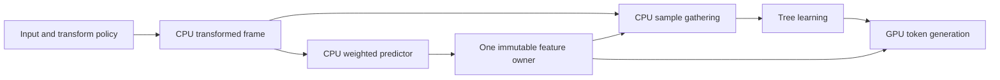

# Shared Modular prediction features

The private adaptive GPU search shares its completed weighted predictions
between learning and token generation by default. Set `adaptive_shared_features`
to `false` in `ModularEncodingOptions`, or append `--no-shared-features` to the
search profiler's Metal route, to use the unshared comparison control.
`--shared-features` remains an explicit enable switch. The option has no effect
on CPU-only or prescribed-policy encoding.

This first slice keeps one active transformed configuration. It removes the
learner's duplicate weighted-predictor recurrence while preserving the existing
candidate order, training samples, learned trees, checkpoint comparisons and
entropy decisions. It does not retain all nine configurations from the earlier
large-photo study.



## Paired performance pilot

On the three original 12 MP photos, mean complete time fell from **75.584 s to
63.952 s: 15.39% less time, or 1.182x**. All complete files and every candidate's
policy, exact cost and tie outcome match. The 18 audited calls comprise two
control/shared pairs per large image plus one pair each for `photo-macan`,
`palette-pattern` and `alpha16-ramp`.

Each large-image entry below is the median of two serial calls; parentheses give
the observed minimum and maximum. The aggregate ratio uses the sum of the three
image medians. These are fresh paired controls, not a comparison with earlier
captures or libjxl latency.

| Image | Unshared s (range) | Shared s (range) | Identical output bytes |
|---|---:|---:|---:|
| 1029 | 78.220 (76.072–80.368) | 65.179 (64.875–65.484) | 10,821,744 |
| 1039 | 73.750 (73.625–73.876) | 62.312 (62.261–62.362) | 7,230,909 |
| 1049 | 74.782 (74.522–75.042) | 64.365 (63.086–65.644) | 7,336,102 |

The eliminated work is directly counted, independently of timing noise:

| Work per large image | Unshared | Shared |
|---|---:|---:|
| Feature-map builds | 25 | 25 |
| Learning calls | 18 | 18 |
| Weighted steps computed by learning | 648,000,000 | 0 |
| Weighted steps reused by learning | 0 | 648,000,000 |
| Total weighted steps computed, both producers | 1,548,000,000 | 900,000,000 |
| Maximum measured managed peak, MiB | 1,105.15 | 1,105.15 |
| Whole-call admission bound, MiB | 6,225.71 | 6,225.71 |

That is **41.86% fewer weighted-predictor evaluations**, counting one
prediction/update step per transformed channel sample. The 25 feature-map builds
remain because this change retains only one configuration, so revisiting an
evicted configuration still recomputes it.

Mean sample-gathering time fell from **13.735 s to 4.272 s**. Feature production
itself stayed approximately constant, **16.758 s versus 16.854 s**, and input plus
transforms fell from **4.692 s to 2.843 s**. These are components already inside
complete time, not additional savings to add to it. About **11.483 s** of feature
production moved from the token column into training. Consequently, top-level
training rose from 46.608 s to 48.420 s even though total computation decreased;
token time fell from 19.474 s to 7.757 s. Comparing those two columns alone would
misattribute the gain.

The smaller-image pairs were 33.527/32.960 s (`photo-macan`), 22.122/22.105 s
(`palette-pattern`), and 14.489/14.143 s (`alpha16-ramp`), control/shared. They also
preserve complete bytes and candidate ledgers. Their small timing differences
are not a separate performance claim from one pair each.

The machine was an Apple M4 Pro with 14 CPU cores and 48 GiB RAM, on battery power
throughout, with an active desktop. Image order was rotated and the first route
alternated across pairs. Power, thermal and process snapshots are retained. Treat
these times as a local pilot, not an idle-machine throughput qualification.

The [audited results](gpu-modular-shared-features-results.json) include the
artifact manifest path, hashes, all per-call stage counters and observations.
The frozen binary has SHA-256
`5137697d91b8253442b7e06f5a6ef507105e01a28f812b3947fbdbaffeaeeb65`.
It was built from base `f05d558140e68a1a98027550bc61355f9293b4fa` plus the retained
uncommitted source patch with SHA-256
`89cc70f700b4755c42cec98dc2462426b4a413f9ed8cc21187bde02e62a0cdbb`.
No implementation changes were made during capture.

This frozen pilot used the initial opt-in implementation: omitting
`--shared-features` selected its control. Sharing was subsequently made the
default, with separate default/opt-out and CPU-only compatibility checks. The
table above retains the frozen pilot's measurements; it is not a new timing
capture of the default change.

## Operation and ownership

`AdaptiveModularTokenCache` now serves both `Learn` and `Encode`:

1. Resolve the source, RCT, transform sequence and weighted parameters against
   the current entry. The input backing and backend are immutable for the
   encoder call. Trees, entropy mode and learning budgets are not cache keys.
2. On a miss, release the previous owner before preparing the new transformed
   frame and completed features. On a hit, keep the existing immutable owner.
3. Learning prepares its CPU frame from the cache's own input and policy, then
   borrows the owner's completed read-only weighted map. The scalar learner
   consumes `{prediction, property15}` in canonical stream/channel/slice raster
   order, with the same row and slice boundaries as token generation.
4. The learner still computes ordinary neighborhood properties and the sampled
   residuals for all 14 predictors. Its sample selection and tree fitting are
   unchanged. With a borrowed map it allocates no weighted-predictor row state
   and does not call the weighted predictor's `Predict` or `Update` methods.
5. GPU token generation consumes the same owner. The temporary CPU frame is
   released before token allocation. The owner is destroyed on eviction or at
   the end of the encoder call; input pointer reuse across calls cannot hit it.

`WeightedPredictorFeature` is a CPU-neutral two-`int64_t` value type, aliased by
the existing GPU ABI. `LearnModularPolicies` accepts an optional borrowed span;
empty selects its scalar oracle. A nonempty span must cover the exact frame and
canonical plan with the same weighted parameters. The cache establishes that
association, validates the producer's metadata/count/descriptors, and checks the
completed host view before lending it to the learner. The owner outlives the
entire synchronous learning call. No feature copy or GPU readback is added.

Missing capability or unsupported device shape detected before production uses
the scalar learner. Errors after production begins, including failed host
borrowing or `Unsupported`, propagate without silently repeating the work on the
CPU. Public output remains unchanged on failure.

## Storage and placement

The existing whole-call admission bound already adds the independent maximum
feature owner to CPU training, fallback, modeling and emission storage. Sharing
therefore needs no increase in the bound. Only one owner is live, and learning
borrows its weighted map without another allocation. A 12 MP RGB layout retains
approximately 720 MB of feature arenas: 144 MB of transformed planes and 576 MB
of weighted values, plus descriptors. This is the existing adaptive token cache's
storage; retaining nine such layouts would be a separate memory policy.

The weighted feature producer is still the CPU bridge. This change removes
redundant CPU work; it does not add a Metal weighted-prediction kernel. Sample
gathering and tree control also remain on the CPU. The existing eligible tree
statistics, token evaluation and population operations retain their GPU routes.
A future GPU producer can supply the same completed owner to both consumers.

## Profiling contract

`feature_seconds` measures feature production across both consumers.
`learning_feature_seconds` is its subset requested by learning, inside top-level
`training`. The difference belongs to top-level `tokens`, along with
`token_seconds`. These intervals must not be added again to complete time.
The learning feature interval is separate from the nested training work stages.

For successful fully eligible calls:

```text
feature_preparations + feature_reuses
    = encoded_candidates + learning_feature_uses
evictions + 1 = feature_preparations
training.weighted_prediction_samples + training.reused_prediction_samples
    = training.population
```

Here `adaptive_gpu.encoded_candidates` counts every GPU token request, including
the final winner re-encode when exact candidate sizing is enabled. With sharing,
the learner's computed weighted count becomes zero and the reused count becomes
the full training population. `feature_samples` counts entries produced across
cache misses. All search entries contain weighted features, so adding this count
to the learner's computed count measures total weighted-predictor evaluations.
This work count distinguishes eliminated computation from changed time attribution.
When learning causes a miss, its prepared CPU frame also feeds feature production,
avoiding a second input/transform pass for the subsequent token request.

## Validation

The Metal workflow suite compares 55 complete CPU/hybrid files and selected
policies, independently decodes 26,119,113 samples through the pinned libjxl
oracle, and completes 7,732 failure-atomic checks. Search cases use the shared default;
prescribed cases retain the old path. Coverage includes all six integer formats,
prefix and ANS, exact and estimated selection, palettes, Squeeze, multiple groups,
thread budgets, legacy/quantized learning and checkpoints.

The dedicated `metal_modular_shared_features` test compares both learners across
all six formats and palette/pattern sources with odd group edges. Its diagnostic
fingerprints include sample positions, every property and all predictor residuals;
policies and growth checkpoints also match the scalar path. It checks custom
weighted parameters, hits across learning modes, eviction/revisiting layouts,
invalid spans, host-borrow failures and unchanged admission bounds. The candidate
search test additionally compares every shared exact-size candidate's policy,
cost and tie outcome against the unshared emission oracle.

Default/opt-out checks also cover CPU-only and prescribed routes, where the
option is inactive. Twenty profiler CLI checks verify default/explicit-enable/
explicit-disable parity for all three Metal search routes, CPU calls in both
builds, profiling disabled, and rejected conflicting or unsupported flags.

Eight CPU-only training, coverage, checkpoint, failure-injection, candidate-search
and profile tests pass. The unchanged Metal token diagnostics continue to compare
weighted features and generated tokens against independent scalar computations.

## Reproducing the paired pilot

Both variants use the same frozen binary, 262,144 training samples, up to 256
leaves, checkpoints, one CPU participant, GPU learner statistics, estimated ANS
selection, exhaustive exact candidate sizing and GPU populations:

```sh
build/release/gjxl_modular_search_profile input.pam output.jxl 262144 256 1 \
  --metal-learn --estimated-ans --candidate-ledger --measure-all --metal-populations
```

Append `--no-shared-features` for the control. New paired captures select both
arms explicitly and use manifest schema 2; the auditor also accepts the original
schema 1 commands without changing their recorded artifacts. Complete-call timing
includes input, transforms, feature production, learning, token generation, entropy work, final
emission and publication. Backend setup, independent decoding and file I/O are
outside that timer. The capture/audit commands are documented in the
[study README](../tools/modular_training_study/README.md).
