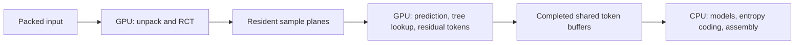

# GPU-resident prescribed prediction and token generation

Status: steps 1–6 are complete, including the private Metal workflow,
correctness/resource gates and [paired performance qualification](modular-gpu-token-performance.md).
The aggregate pilot performance gate passes; public routing remains unchanged
pending an independent quiet-session repeat and scoped dispatch design. This follows the
[unpack/RCT performance qualification](modular-gpu-performance.md). The private
complete encoder composes both GPU operations with full-call admission and one
completion wait. Public encoder routing is unchanged.

This slice consumes unpacked/RCT planes directly on the GPU and hands
completed token buffers to the existing CPU entropy encoder. Completed shared
token buffers and explicit ownership are part of the initial design: copying a
larger token representation back to CPU could consume the savings.

The saved profiles give this a more meaningful opportunity than unpack/RCT
alone. Preparation plus tokenization accounts for about 24% of serial 4K RGB8
encoding, or 20% with four CPU participants. Eliminating that work entirely
would imply ceilings of roughly 1.31× and 1.24×, respectively. These are upper
bounds derived from the saved stage profiles, not predicted speedups. GPU
execution, synchronization and CPU consumption still cost time, and CPU
modeling and entropy emission remain major costs.

## Scope

The slice supports all six existing packed input formats and
their prescribed RCTs, all 13 nonweighted predictors, and prescribed trees using
properties 0–14. Keep the current 31-node/16-leaf limits and exact leaf
offset/multiplier semantics. Both prefix and ANS use the same resulting tokens.

Weighted prediction, property 15, additional transforms and policy search remain
outside this slice. A supplied tree must satisfy the same eligibility checks
regardless of how it was selected. Tree learning, entropy-model selection,
entropy coding and codestream assembly remain on CPU. The new path remains a
private qualification entry point until complete-call performance evidence
supports a dispatch policy.

## 1. Define the operation, eligibility and storage contract

Specify immutable source planes, canonical stream/channel slices, the prescribed
tree, token ordering, ownership and failure behavior. Each sample produces
exactly one token, so the CPU can calculate every output offset before launch.
No GPU sizing pass, compaction or atomic append is needed. Reject unsupported
policies before allocation or submission.

Use compact `uint32` values plus `uint16` contexts, matching the existing
[entropy stream interface](../src/codestream/entropy.h). Preserve canonical
stream order, channel order within each stream, and row-major sample order
within each slice, including empty streams and their canonical IDs.

The storage plan must account for actual overlapping lifetimes: upload, sample
planes, token buffers, descriptors, status storage and the CPU continuation.
The composed path can keep upload, planes and tokens alive together until its
completion fence; reusing the previous slice's phase maximum without accounting
for this overlap is insufficient. Retained token backing remains charged through
CPU consumption. Existing output stays charged separately during replacement.

The private [operation contract](../src/gpu/ops/modular_tokenization.h) defines
`GpuModularTokenGeneration`, `PreparedGpuModularTokens` and optional borrowing of
completed host-readable token views. `ResolveModularTokenEligibility` validates
the policy and compiles fixed-width tree nodes with scalar breadth-first leaf
contexts. Malformed inputs return `InvalidArgument`; supported CPU features
outside this GPU slice return `Unsupported`. Residual divisibility/range remains
a sample-dependent runtime check, represented by a checked device status word.

The [device storage planner](../src/gpu/ops/modular_token_storage_plan.h) sizes two
arenas with 256-byte aligned regions. The retained arena contains `uint32` values
and `uint16` contexts. The transient arena contains 32-byte slice records, all
31 32-byte tree-node slots and a `uint32` error word. Token offsets use 64 bits;
descriptor coordinates and canonical IDs have checked 32-bit bounds. A fresh
host staging vector is conservatively included for dispatch upload; direct
shared-buffer initialization may use less.

The [codestream planner](../src/codestream/modular/gpu_token_plan.h) keeps stream
policy out of the GPU operations layer:

| Boundary | Contract |
| --- | --- |
| `ComputeGpuModularTokenStoragePlan` | Allocation-free shape/policy planning; optional actual backend limits; no samples or device initialization |
| `BuildGpuModularTokenPlan` | Fresh managed host metadata only; canonical CPU streams/slices plus GPU slice descriptors and per-stream token ranges |
| Generation peak | Packed upload + resident planes + token arena + dispatch arena + dispatch staging + host layout |
| Retained backing | Token arena + host layout; no upload, planes, dispatch arena or staging |
| CPU continuation | Step 4 adds modeling/emission work to retained backing exactly once, then compares with generation/assembly/publication phases |

These are preparation/retention bounds, not a complete encoder reservation or
process RSS. Shape planning and metadata construction preserve old outputs on
failure. Existing outputs are charged separately; metadata construction uses the
ambient reservation or default managed tracking. Runtime backends must supply
both input and token limit sets before allocating device storage. No new headers
are installed.

`modular_gpu_token_plan` is a CPU-only qualification target, also registered in
native Modular CI. It checks the supported format/RCT/predictor matrix, tree
properties and context numbering, exact stream coverage, compact/aligned storage,
limits and large shape-only offsets, scalar token-range agreement, actual managed
metadata capacity and failure-atomic replacement at every metadata allocation.
It also verifies that a live old plan remains charged during replacement: a
reservation fitting only the fresh candidate rejects replacement atomically,
then succeeds after the old plan is released.

Local qualification on 2026-10-10 used an isolated source snapshot of `9cf3b02`
plus the eight contract/code/build files, excluding concurrent CPU search edits.
The new target passed 2,210 supported policies and 132 layouts. Five focused
tests (stream planning, GPU input, token planning, preparation and workflow)
passed in both C++20 Release and C++23 ASan/UBSan CPU-only builds. The Metal
library built successfully and the contract test passed with Metal enabled.
Apple LeakSanitizer was unavailable, so the sanitizer run used
`ASAN_OPTIONS=detect_leaks=0`; managed backing and charge lifetimes were checked
by the tests. Source hashes, build/test logs and qualification metadata are
retained locally in `build/modular-token-contract-qualification/`. These checks
qualify the contract and metadata planner, not a GPU token producer.

## 2. Establish the CPU consumer and ownership boundary

[`PreparedModularTokens`](../src/codestream/modular/tokenization.h) is now
explicitly move-only. It retains either scalar interleaved storage or a completed
`PreparedGpuModularTokens` owner alongside the stream views. Both producers use
the same allocation-free tree-header builder, preserving policy serialization
and breadth-first contexts.

The private [handoff](../src/codestream/modular/gpu_token_handoff.h),
`AdoptGpuModularTokens`, accepts the canonical plan used by the producer and its
completed owner. It validates policy, counts, stream coverage and borrowed host
view sizes before allocating one vector of `EntropyTokenStreamView::Split`
records. It transfers the owner only after all fallible work succeeds. Failed
borrowing, malformed ranges, allocation failures and insufficient reservations
preserve both the incoming owner and any previous output. Borrowing does not
map arbitrary device ranges or fall back to a token copy. Token contents and
successful device completion/status validation remain the producer's contract.

`ComputeGpuModularTokenHandoffStorageBound` accounts for the fresh stream-view
vector only. Add it to the already-live plan and token arena; the arena keeps
its original charge, and old output remains separately charged during replacement.
Step 1's preparation/retention bounds exclude this new view vector. Complete
GPU-call admission, including CPU modeling/emission, is defined in step 4; the
scalar workflow reservation is not a GPU continuation reservation.

The existing [`EncodeModularFrame`](../src/codestream/modular/frame_encoder.cpp)
scope keeps either backing representation alive through model selection and
every joined entropy worker, then releases it before assembly. Failures after
consumption also release the owner after joining; initial argument-validation
failures leave it with the caller. Prefix and ANS consumers need no new token
representation or emission algorithm.

The CPU-only `modular_gpu_token_handoff` target is registered in native CI. Its
completed-owner stand-in uses one managed arena with the actual compact layout;
borrowing retains pointer identity and adds only the view-vector charge. It
checks moves, cross-thread destruction, both scalar/GPU replacement directions,
rejection before allocation, live-old-output budget pressure, model failures,
partial worker-launch failures, assembly/publication failures and recovery.
The real frame consumer produces byte-identical results for 202 cases covering
all six formats, global/grouped and clipped layouts, prescribed split/maximal
trees, leaf multipliers, prefix/ANS, and one/four CPU participants. This qualifies
the consumer boundary independently of a Metal token kernel.

Local qualification on 2026-10-10 uses frozen base `710d291` (including CPU RCT
selection) plus the eight step-2 code/build files. The C++20 Release checks passed
11 focused tests, including the pinned-libjxl oracle, conformance, policy and
transform suites. The existing workflow test also passed with allocation-failure
shard `0/64`; that run does not claim the full 64-shard sweep. Five CPU-only
C++23 ASan/UBSan tests passed with leak detection
disabled on this Apple toolchain. The Metal library and handoff test also built
and passed. Source hashes and logs are retained locally in
`build/modular-token-handoff-qualification/`; no GPU production or performance
claim follows from these consumer checks.

## 3. Implement and qualify the Metal token kernel

The [Metal kernels](../src/gpu/metal/kernels/modular_tokens.metal) implement a
specialized prescribed gradient leaf and the full nonweighted prescribed-tree
scope. A two-dimensional grid assigns one sample per thread and one slice per
grid row, writing directly into predetermined compact token ranges. The current
[scalar tokenization](../src/codestream/modular/tokenization.cpp),
[predictor arithmetic](../src/codec/modular/scalar_prediction.h) and
[tree properties](../src/codec/modular/tree.h) remain the oracle.

The main correctness details are:

- Neighbors and coordinates are slice-local, including group-edge substitutions.
  A neighboring sample outside the slice must not leak into prediction simply
  because it exists in the full resident plane.
- Property 8 uses the previous pixel's unclamped gradient, with zero at each row
  start. Recompute that gradient from immutable neighbors using the same edge
  rules; it does not require serial execution or a separate scan.
- Preserve predictor division rounding, select ties, tree branch direction and
  breadth-first leaf context numbering.
- Use sufficiently wide arithmetic for offsets and residuals. Check exact
  divisibility and signed range before applying the existing signed packing.

The kernels use bounded 32-bit neighborhood arithmetic and signed 64-bit leaf
adjustment/division. Nonintegral or out-of-range residuals atomically set the
device error word. The specialized gradient path has no tree traversal or leaf
division; its bounded residuals preserve the same output contract.

The [Metal producer](../src/gpu/metal/metal_modular_tokens.cpp) checks native
ownership, metadata/RCT, dense input plane ranges, nonaliasing and canonical
clipped slices before allocating or submitting. Host/shader ABI assertions check
every descriptor field. It initializes descriptors, compiled nodes and status
directly in shared dispatch storage, avoiding the conservative staging allowance.
The operation uses the ambient reservation, two fresh device allocations, one
submission and one completion wait. It publishes the owner only after successful
completion and status validation; failures drain work before releasing storage
and preserve the previous owner. The completed owner retains only the token
arena and its original charge. Repeated host borrowing allocates and copies
nothing. CPU participation is suspended during the GPU wait.

The `metal_modular_tokens` CTest target exercises file-loaded and embedded
libraries, all six formats, both byte orders, every eligible RCT and all 13
predictors. Split trees cover properties 0–14, permuted child indices,
breadth-first contexts and the 31-node/16-leaf limit. Cases include odd offsets
and strides, transparent colors, signed leaf extrema, exact/nonintegral
division, narrow images, clipped 255/256/257 boundaries and canonical stream ID
changes across DC groups. Allocation/submission/completion faults, rejected
foreign or malformed inputs, retained-owner replacement pressure, tight memory
caps, immutable sources, CPU participation and four concurrent calls are checked.

Selected cases pass real device tokens through step 2's handoff and the existing
frame encoder under prefix/ANS and one/four CPU participants. This is a test
harness with separate preparation and token-generation submissions, not step 4's
composed production workflow or full-call reservation. Complete file bytes are
compared with scalar output; configuring `GJXL_MODULAR_ORACLE_BUILD` additionally
requires independent decoding to the original integer samples.

Local qualification on 2026-10-10 used an isolated snapshot of `fa4d9f3` plus
the eight step-3 code/build files, on Apple M4 Pro. The new target passed 5,195
cases comparing 49,630,564 tokens, with 68 byte-identical complete files and
2,295,440 independently decoded samples using pinned libjxl `e8ff097`. The same
matrix passed with Metal API and GPU validation enabled. Eight focused C++20
Release tests passed with Metal enabled, including existing unpack/RCT and
workflow tests; five focused CPU-only tests also passed.

C++23 ASan/UBSan passed the two CPU contract/handoff tests without vendor
suppressions and the native Metal token matrix with only
`null:*/third_party/metal-cpp/*Foundation/NSObject.hpp` suppressed. Leak detection
was disabled. The unsuppressed Metal run stops at the existing vendor nil-call
idiom; its log is retained. Linking the unsanitized pinned libjxl archive into
the sanitizer executable also produced a container-annotation failure inside
the oracle, so independent decoding remains a separate Release gate. All 68
native sanitizer output hashes match the independently decoded Release files;
no container-overflow check was disabled. These are scoped host sanitizer and
device validation results, not an unsuppressed sanitizer-clean claim.

Source, binary, library and codestream hashes, the patch, build/test logs and
qualification metadata are retained locally in
`build/modular-token-kernel-qualification/`. Step 5 below adds intermediate
prediction/property diagnostics and qualification of the composed workflow.
No complete-call performance or dispatch-policy claim follows from these
kernel results.

## 4. Compose preparation and tokenization into the complete encoder

The private [complete token workflow](../src/codestream/modular/gpu_token_workflow.h)
provides owned-buffer and vector publication routes. `PrepareModularTokens`
records unpack/RCT, an explicit sample-buffer memory barrier and token generation
into one compute command buffer, with four device allocations and one completion
wait. Upload, resident planes and dispatch scratch are released before returning
the completed token owner. Standalone preparation and resident-plane token
generation retain their separate contracts.

The workflow builds canonical metadata, invokes this composed producer, adopts
the compact token backing and feeds it directly into `EncodeModularFrame`.
It releases GPU descriptors/ranges before CPU modeling, retaining only canonical
layout and token views/backing. CPU tree serialization, modeling, headers,
entropy coding and publication are shared with the prescribed scalar path.
There is no host plane reconstruction, CPU tokenization or fallback. A separate
`gpu_input_tokens` profile interval covers the combined preparation/handoff
boundary; it is not a kernel timing.

`ComputeGpuModularTokenWorkflowStoragePlan` admits the maximum of generation,
handoff and CPU continuation. Generation includes overlapping upload, planes,
tokens, dispatch and layout. Handoff adds fresh stream views to retained token
and plan storage. `ComputeModularTokenConsumerStoragePlan` constructs CPU phase
bounds with compact backing counted once; it omits scalar sample/token work.
GPU descriptors/ranges are absent from subsequent phases. This derives bounds
from actual retained representations without subtracting unrelated phase maxima.
Old output remains separately charged. Admission precedes metadata allocation
and CPU participation, reuses a same-domain outer reservation, and preserves
previous output on every failure.

## 5. Qualify correctness, resources and failures

The [diagnostic hook](../src/gpu/metal/metal_modular_tokens.h) uses a specialization
of the same kernel arithmetic to expose all 13 nonweighted predictions, all
15 supported properties, the selected leaf/context and residual/token. Its
guarded trace arena and token padding/trailing guards are checked after
completion. Diagnostic buffers are excluded from production calls and their
storage/performance bounds.

The device matrix checks 1,004,674 intermediate sample traces against scalar
neighborhood arithmetic and lookup. Both standalone and composed producers
separately pass 5,195 cases and 49,630,564 exact token comparisons. Coverage
includes all supported format/RCT/predictor combinations, properties 0–14,
signed leaf extrema/divisibility, transparent colors, odd offsets/strides, narrow
and 255/256/257 boundaries, clipped groups and DC-group IDs. Each producer also
passes 68 complete-file comparisons and independent decoding.

`metal_modular_token_workflow` checks 795 complete files against scalar bytes and
6,732,696 original integer samples with pinned libjxl, under prefix/ANS and
one/four CPU participants. Its 786 injected failures cover managed allocations
through final publication, all four device allocation boundaries, submission,
completion and partial CPU worker launch. It checks retained-output replacement,
cross-thread destruction, four concurrent calls under one-call capacity, nested
domain admission, explicit errors and recovery. Existing preparation/workflow
tests remain enabled. The CPU-only workflow target additionally verifies
allocation-free composed planning and admission/rejection before device work.

Local qualification uses an isolated `fa4d9f3` snapshot with the step-3–5 overlay
on Apple M4 Pro. All six focused Metal/workflow tests passed with Metal API/GPU
validation. Eight CPU-only Release tests passed, plus scalar workflow allocation
shard 0/64; this does not claim the full scalar search fault sweep. C++23
ASan/UBSan passed two CPU tests without vendor suppressions and three native
Metal tests with the same narrowly scoped vendor null-call suppression described
above, with leak detection disabled. All 931 retained native sanitizer files
match the independently decoded Release outputs by SHA-256. Source hashes,
logs and qualification metadata are in `build/modular-token-workflow-qualification/`.

## 6. Run paired end-to-end performance qualification

The [performance report](modular-gpu-token-performance.md) compares CPU, the
existing GPU-preparation path and the composed token path from one frozen
`fa4d9f3` plus overlay snapshot. All three use identical prescribed decisions
and complete bytes. The 56-case matrix adds three original 12 MP photographs
and prescribed split trees, with one/four CPU participants and four-call
workloads under matching caps. Timing includes admission, allocation, upload,
synchronization, handoff, CPU continuation and publication. Setup and stage
diagnostics remain separate.

The [token protocol](../tools/modular_oracle/GPU_TOKENS_PERFORMANCE.md) and
`acceptance.json` fixed the cases and thresholds before timing. All six
four-participant primary photo cases pass the aggregate 5% median speedup bar
with intervals excluding parity against both controls: 1.068–1.231× versus CPU
and 1.081–1.251× versus preparation. All five four-call cases pass the 2%
regression tolerance. Every warmup, ordinary and profile call passes exact
bytes/resource checks; 6,549 complete encodes were checked overall.

The route remains private. Tiny inputs regress, large-photo ANS gains are small
or inconclusive, and one primary CPU comparison has a cohort median below 5%.
Other codec tests overlapped the beginning of the first cohort, with normal
desktop activity throughout. An independent quiet-session repeat is still
required before promotion. The report retains all cohorts and documents these
limits; the pilot does not establish a general dispatch threshold.

Source/binary/library/input/output/raw-result hashes and logs are retained in
`build/modular-token-performance-build/` and
`build/modular-token-performance-20261010/`. The earlier unpack/RCT results
remain evidence for their original `155e60e` revision, not this run's control.

Histogram generation can follow as a separate slice once these measurements
show whether modeling deserves GPU work. It is not required to establish this
token producer/consumer boundary.
